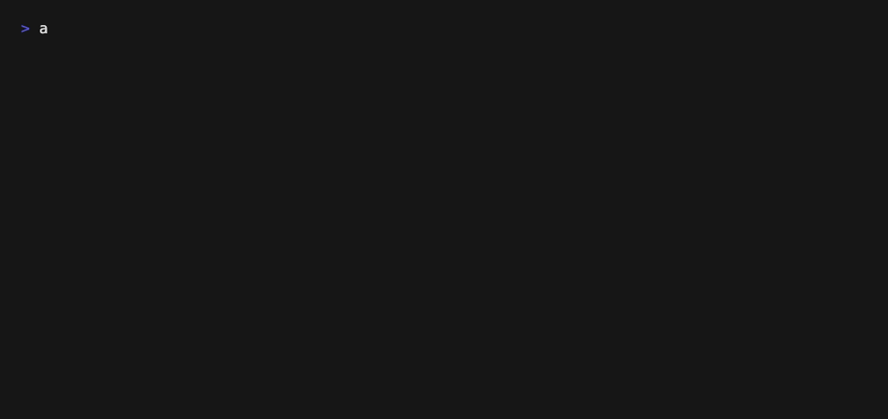

**English** | [简体中文](./README.md)

<p align="center">
  <picture>
    <source media="(prefers-color-scheme: dark)" srcset="./assets/brand-hero-dark.svg">
    <source media="(prefers-color-scheme: light)" srcset="./assets/brand-hero-light.svg">
    
  </picture>
</p>

<p align="center">
  
  
  
  
  
</p>

<h1 align="center">absentia</h1>

<p align="center"><strong>Local archive verification: a coverage-bounded receipt for the answer "no".</strong></p>

RAG can show you what is there. It cannot show that an exhaustive search found nothing: when recall comes back empty, "not retrieved" and "genuinely absent" look the same. absentia turns one empty result into a file you can audit — pages read, phrasings tried, comparisons run, the threshold in force, and which pages never entered the index. The verdict reads numbers only; no language model sits in the decision path, and a second party can recompute the whole thing on their own machine.

---

## Quickstart

Python 3.12 or newer is required (CI currently tests 3.12 only). The lexical channel works without any embedding endpoint; the semantic channel needs a local OpenAI-compatible endpoint — see [Semantic channel](#semantic-channel).

**Before the first public release**: install from your local checkout of the repository:

```bash
# Before the first public release: clone your local checkout
git clone <path to your local checkout> absentia-attest
cd absentia-attest
python3.12 -m venv .venv
. .venv/bin/activate
pip install -e .
absentia --version
```

Once the repository is public, replace the first line with `git clone https://github.com/SuperMarioYL/absentia-attest.git`.

Output:

```text
absentia 0.1.0
```

Run it against the seven bundled files (four sets of town mayor's office meeting minutes, one procurement ledger, one finance summary, one archive index). First build the manifest:

```bash
absentia index fixtures/seed_archive
```

```text
7 文档 / 7 页（已解析 7）/ 21 段 / 0 个文件未解析
清单  .absentia/manifest.json
索引  .absentia/index.sqlite
manifest_sha256  b59e497de998c0501208749c2e812712b86d59c8bf0ac4d5a4d972608fcff09e
```

Ask a question the archive really answers:

```bash
absentia check "道路监控摄像头采购" --archive fixtures/seed_archive
```

```text
7 页中 7 页已解析并逐段打分，4 种口径改写 × 21 段 = 84 次比对，最高相似度 1.00 ≥ 阈值 0.62，判定：命中（有）；未解析 0 页已列出
PRESENT（命中（有）） 最高分 1.00 / τ 0.62 · 84 次比对 · 仅词法
注意：未配置嵌入端点，本次只跑了词法通道，因此不出具 ABSENT_BOUNDED。配置 --endpoint 后可复算语义通道。
凭证  .absentia/attestation.json
台账  .absentia/ledger.md
core_sha256  95b4e0734dd926f861c7c027283bef62db4b6840ae057f1f304ecb5d2fd90856
```

Now ask something the archive does not contain (Flock is licence-plate recognition; the procurement record explicitly says the cameras had no recognition software):

```bash
absentia check "Flock 摄像头采购" --archive fixtures/seed_archive
```

```text
7 页中 7 页已解析并逐段打分，4 种口径改写 × 21 段 = 84 次比对，最高相似度 0.25 < 阈值 0.62，判定：无法判定；未解析 0 页已列出
INCONCLUSIVE（无法判定） 最高分 0.25 / τ 0.62 · 84 次比对 · 仅词法
注意：未配置嵌入端点，本次只跑了词法通道，因此不出具 ABSENT_BOUNDED。配置 --endpoint 后可复算语义通道。
凭证  .absentia/attestation.json
台账  .absentia/ledger.md
core_sha256  181e3e900d0c60115f96d4d995d94e27b849183dd3216836bb48a4590eb58343
```

Read the `注意` line carefully: the recording machine had no local embedding endpoint, so only the lexical channel ran. A literal miss is not an absence. absentia refuses to emit `ABSENT_BOUNDED` in that state and records the boundary instead. That is the product working, not failing.

Recompute the attestation:

```bash
absentia verify .absentia/attestation.json
```

```text
AGREES  判定 INCONCLUSIVE → 复算 INCONCLUSIVE
claimed core_sha256     181e3e900d0c60115f96d4d995d94e27b849183dd3216836bb48a4590eb58343
recomputed core_sha256  181e3e900d0c60115f96d4d995d94e27b849183dd3216836bb48a4590eb58343
```

`verify` rebuilds the index in a temporary directory. It does not touch the audited archive or overwrite the original attestation. Exit codes: `0` agrees, `3` disagrees, `4` inconclusive.

## Demo

<p align="center">
  
</p>

The GIF is recorded from the real binary driven by `assets/demo.tape`; nothing is staged or edited afterwards. The full one-page ledger is in [`docs/demo/ledger-card.md`](./docs/demo/ledger-card.md); every command, raw output and digest is in [`docs/demo-results.json`](./docs/demo-results.json).

| Recorded item | Measured value |
| --- | --- |
| Archive | `fixtures/seed_archive`, 7 documents |
| Pages / chunks | 7 pages parsed, 21 chunks |
| Phrasings | 4 (verbatim, traditional, alias, synonymous verb) |
| Comparisons | 4 × 21 = 84, the full Cartesian product, no sampling |
| Top score, absent claim | 0.25 < τ 0.62 |
| Top score, present claim | 1.00 ≥ τ 0.62, citation in `procurement_ledger.md` page 1 |
| `verify` result | `AGREES`; both attestations recomputed byte for byte |

Because the recording host had no embedding endpoint, the absent claim is `INCONCLUSIVE` (`lexical_only`), not `ABSENT_BOUNDED`. The `ABSENT_BOUNDED` path is covered by the test suite with a stand-in embedder; with `bge-m3` wired to a local endpoint, the same command exercises the semantic channel for real.

## Why this exists

Point a long-context model, or a RAG stack, at sixteen years of meeting minutes and ask whether something was ever mentioned. You get one of two outcomes: a citation, or nothing. The citation proves presence. The empty answer collapses three very different situations into one sentence — it truly is not there, the model never read that part, or retrieval never returned it.

How the approaches divide the work:

| Approach | Proves "yes" | Proves "no" | Records coverage | Third party can recompute |
| --- | --- | --- | --- | --- |
| Whole corpus in a long context | Yes | No: an empty answer cannot distinguish a miss from absence | No | No; a different quantization can flip it |
| RAG with citations | Yes | No: empty recall and true absence look alike | Usually not recorded | Partly, depending on retrieval logs |
| grep / search engine | Literal matches | Literal absence only | Logs are inspectable | Yes, but it cannot cover paraphrases |
| **absentia** | Yes, with page and chunk | Yes, provided the semantic channel covered every chunk | Yes, per chunk | Yes; `verify` recomputes the entire `core` |

It does not try to find answers better than RAG. It fills a different slot: when the conclusion has to be "no", the person signing it needs a bound that the next auditor can recompute.

### Three design decisions

1. **Sentence embeddings score every chunk; the model is never asked to read page by page.** With the semantic channel available, coverage is therefore 100% by construction, and "absent" can only mean "all N×M scores fell below τ", not "the model said it did not see it".
2. **The model is not in the decision path.** The verdict reads two numbers: the highest N×M score and the configured τ. The optional cross-check by a chat model lives outside the hash; remove it and both `verdict` and `core_sha256` stay unchanged.
3. **Phrasing variants are deterministic.** Simplified/traditional, full name/alias, officialese and synonymous verbs come from a built-in lexicon — no sampling, no model. The same claim produces the same variant set on any machine, which is what makes recomputation meaningful.

The lexical tokenizer is a hard constraint too: the table is always `fts5(tokenize='trigram')`. SQLite's default `unicode61` treats a whole run of Chinese as one token, so queries like 「摄像头」 match nothing; trigram matches substrings of three characters or more, two-character Chinese terms fall back to `LIKE`, and the attestation records which path actually ran.

## How it works

```text
archive ──▶ ingest.py    parse → paginate → chunk → manifest.json (sha256 manifest)
claim   ──▶ variants.py  simplified/traditional, alias, synonymous verb — deterministic
            scan.py      N×M scores: FTS5 trigram + local embeddings, combined with max
            attest.py    verdict + core_sha256; verify recomputes in a temp directory
            render.py    ledger.md (one page)
```

The verdict table reads numbers only:

| Condition | Verdict |
| --- | --- |
| No scorable chunks, or no parsed pages | `INCONCLUSIVE` (`empty_corpus`) |
| Top score ≥ τ | `PRESENT` (`score_at_or_above_tau`) |
| Top score < τ and only the lexical channel ran | `INCONCLUSIVE` (`lexical_only`) |
| Top score < τ and the semantic channel covered every chunk | `ABSENT_BOUNDED` (`all_scores_below_tau`) |

The attestation separates a protected `core` from an unprotected `auxiliary`. Timestamps, absolute machine paths and model sampling results live in `auxiliary` and never enter the hash; every field in `core` can be recomputed by a third party. Field-level documentation, the scoring formulas and the verification procedure are in [`docs/attestation-format.md`](./docs/attestation-format.md).

## Commands

```text
absentia index ARCHIVE [--out DIR]
absentia check CLAIM --archive DIR [--out DIR] [--tau T]
                [--endpoint URL] [--embed-model NAME]
                [--model NAME] [--adjudicate] [--json]
absentia verify ATTESTATION [--archive DIR] [--tau T]
                 [--endpoint URL] [--embed-model NAME] [--json]
absentia mcp [--archive DIR]
```

| Command | What it does |
| --- | --- |
| `index` | Rebuilds `manifest.json` and `index.sqlite`; prints pages, chunks and the parse-failure ledger |
| `check` | Generates phrasings, runs the N×M pass, writes `attestation.json` and `ledger.md` |
| `verify` | Recomputes the attestation field by field and reports `AGREES` / `DISAGREES` / `INCONCLUSIVE` |
| `mcp` | Starts a stdio MCP server exposing `absence_check` and `absence_verify` |

`--tau` changes the verdict and the recorded `bound` together. `--json` prints the complete attestation for use in another pipeline. `--adjudicate` has a local chat model sample the top-scoring passages; the agreement rate is written to the ledger but never affects the verdict.

### Semantic channel

The semantic channel talks to a local OpenAI-compatible endpoint. No torch, no hosted API. With Ollama (install Ollama and pull the embedding model first):

```bash
ollama pull bge-m3
absentia check "Flock 摄像头采购" --archive fixtures/seed_archive \
  --endpoint http://127.0.0.1:11434/v1 --embed-model bge-m3
```

An unreachable endpoint does not crash the run: the tool degrades to the lexical channel, sets `bound.lexical_only=true`, records the exception class in `bound.embedding_error`, and refuses `ABSENT_BOUNDED`. It never does partial coverage — half the chunks embedded and half not is the most dangerous state.

### MCP

```json
{
  "mcpServers": {
    "absentia": {
      "command": "absentia",
      "args": ["mcp", "--archive", "/path/to/archive"]
    }
  }
}
```

The server implements the stdio transport directly as newline-delimited JSON-RPC 2.0, with no third-party SDK; stdout carries protocol frames only and diagnostics go to stderr. `absence_check` returns the attestation and its path; `absence_verify` returns the verification report.

## Known limits

- **No OCR.** v0.1 handles text-layer PDF, DOCX, TXT and MD. Scanned pages go into the `excluded` ledger; their pages count as unreviewed and never enter `parsed_pages`.
- **No incremental indexing.** Every `check` rebuilds from scratch. That is the price of recomputability, and a deliberate one.
- **The phrasing lexicon covers three Chinese rewrite families only**: simplified/traditional, full name/alias, and officialese/synonymous verbs. Dialects and foreign languages are out of scope for v0.1.
- **`calibration_recall` is a fixed table shipped with the package**, not a measurement on your corpus. A private archive has no labelled query set; this cannot be papered over.
- **Pure-Python dot products.** v0.1 does not bring in numpy; the bundled demo archive has 21 chunks and the repository contains no benchmark for larger archives.
- **Recomputability of the semantic channel depends on the local model being deterministic.** Changing the quantization changes `matrix.sha256`; the attestation exposes that difference instead of pretending it agrees.
- **`verify` only connects automatically to loopback endpoints** (`localhost` / `127.0.0.1` / `::1`). If the attestation records a remote endpoint, a human must pass `--endpoint` explicitly, so archive text is never sent to an unknown host by default.

## Pricing

The CLI is open source under MIT. Individuals, journalists and monitoring groups can use every v0.1 command free of charge.

The only paid layer is the one that turns a ledger into an archival workpaper: **audit workpaper xlsx and signature-page export, plus batch concurrency**. It ships in v0.2, is not implemented in v0.1, and is not being charged for today. Pricing is quoted per seat / per year; contact [leo.stack@outlook.com](mailto:leo.stack@outlook.com), or open an issue on the repository to discuss a pilot.

The right next step today is a two-week pilot on your own old workpapers: confirm whether this coverage number can go straight into a workpaper. Purchasing and delivery start with v0.2.

## Roadmap

- **v0.1.0 (current)** — m1 manifest and parse-failure ledger; m2 multi-phrasing hybrid scoring, verdict and verification; m3 stdio MCP server. The CLI commands `index` / `check` / `verify` / `mcp` all work.
- **v0.2** — the paid layer: audit workpaper xlsx and signature-page export, batch concurrency; PyPI distribution (after release, `uv tool install absentia-attest` becomes available).
- **Unscheduled** — OCR for scanned pages, incremental indexing and directory watching, non-Chinese phrasing lexicons. None of these are promised in v0.1.

## License

[MIT](./LICENSE). The attestation format, verdict rules and verification procedure are in [`docs/attestation-format.md`](./docs/attestation-format.md); changes are recorded in [`CHANGELOG.md`](./CHANGELOG.md).

<p align="center"><sub><a href="./LICENSE">MIT</a> © 2026 SuperMarioYL</sub></p>
