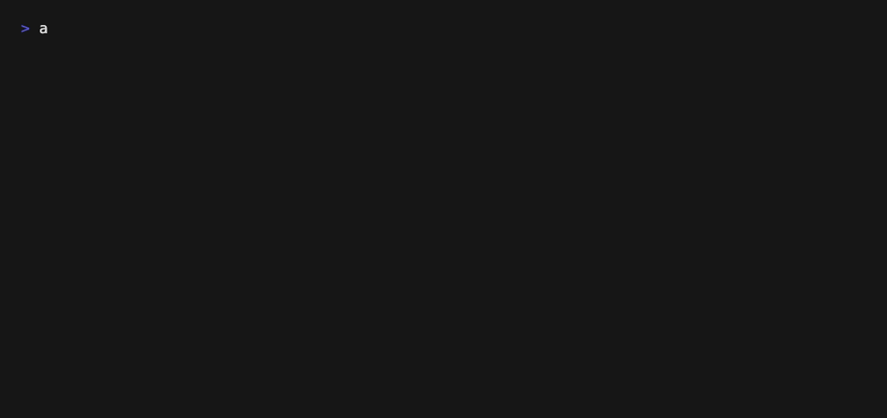

[English](./README.en.md) | **简体中文**

<p align="center">
  <picture>
    <source media="(prefers-color-scheme: dark)" srcset="./assets/brand-hero-dark.svg">
    <source media="(prefers-color-scheme: light)" srcset="./assets/brand-hero-light.svg">
    
  </picture>
</p>

<p align="center">
  
  
  
  
  
</p>

<h1 align="center">absentia</h1>

<p align="center"><strong>本地档案查证：为否定结论出具带覆盖度的缺席凭证。</strong></p>

RAG 能给出「有」的引文。它给不出「穷尽检索之后仍然没有」的凭证——召回为空时，「没检索到」和「确实没有」是同一个输出。absentia 把一次空结果变成一份可复核的文件：读了多少页、用了几种口径、比对了多少次、阈值是多少、哪些页没读进去。判定只看数字，模型不在判定路径里；另一个人可以在自己的机器上重算。

---

## 快速开始

需要 Python 3.12（当前只在 3.12 上验证）。没有本地嵌入端点也能跑词法通道；语义通道需要一个本机 OpenAI 兼容端点，见[语义通道](#语义通道)。

```bash
git clone https://github.com/SuperMarioYL/absentia-attest.git
cd absentia-attest
python3.12 -m venv .venv
source .venv/bin/activate
pip install -e .
absentia --version
```

输出：

```text
absentia 0.1.0
```

用仓库自带的 7 份镇务会议纪要与采购台账跑一遍。先建清单：

```bash
absentia index fixtures/seed_archive
```

```text
7 文档 / 7 页（已解析 7）/ 21 段 / 0 个文件未解析
清单  .absentia/manifest.json
索引  .absentia/index.sqlite
manifest_sha256  b59e497de998c0501208749c2e812712b86d59c8bf0ac4d5a4d972608fcff09e
```

问一条档案里确实有答案的命题：

```bash
absentia check "道路监控摄像头采购" --archive fixtures/seed_archive
```

```text
7 页中 7 页已解析并逐段打分，4 种口径改写 × 21 段 = 84 次比对，最高相似度 1.00 ≥ 阈值 0.62，判定：命中（有）；未解析 0 页已列出
PRESENT（命中（有）） 最高分 1.00 / τ 0.62 · 84 次比对 · 仅词法
注意：未配置嵌入端点，本次只跑了词法通道，因此不出具 ABSENT_BOUNDED。配置 --endpoint 后可复算语义通道。
凭证  .absentia/attestation.json
台账  .absentia/ledger.md
core_sha256  95b4e0734dd926f861c7c027283bef62db4b6840ae057f1f304ecb5d2fd90856
```

再问一条档案里没有的命题（Flock 是车牌识别系统，而这批采购里明确写着监控设备「不含识别软件」）：

```bash
absentia check "Flock 摄像头采购" --archive fixtures/seed_archive
```

```text
7 页中 7 页已解析并逐段打分，4 种口径改写 × 21 段 = 84 次比对，最高相似度 0.25 < 阈值 0.62，判定：无法判定；未解析 0 页已列出
INCONCLUSIVE（无法判定） 最高分 0.25 / τ 0.62 · 84 次比对 · 仅词法
注意：未配置嵌入端点，本次只跑了词法通道，因此不出具 ABSENT_BOUNDED。配置 --endpoint 后可复算语义通道。
凭证  .absentia/attestation.json
台账  .absentia/ledger.md
core_sha256  181e3e900d0c60115f96d4d995d94e27b849183dd3216836bb48a4590eb58343
```

注意最后一行提示：这台录制机没有本地嵌入端点，所以这次只跑了词法通道。字面没命中不等于缺席——absentia 拒绝在这种情况下出具 `ABSENT_BOUNDED`，而是把边界写进凭证。这是产品行为，不是失败。

复算这份凭证：

```bash
absentia verify .absentia/attestation.json
```

```text
AGREES  判定 INCONCLUSIVE → 复算 INCONCLUSIVE
claimed core_sha256     181e3e900d0c60115f96d4d995d94e27b849183dd3216836bb48a4590eb58343
recomputed core_sha256  181e3e900d0c60115f96d4d995d94e27b849183dd3216836bb48a4590eb58343
```

`verify` 在临时目录重建索引，不碰被审档案，也不覆盖原凭证。退出码：`0` 一致，`3` 不一致，`4` 复核条件不足。

## 演示

<p align="center">
  
</p>

上面这段 GIF 由 `assets/demo.tape` 驱动真实二进制录制，没有剪辑或补写。完整的一页台账见 [`docs/demo/ledger-card.md`](./docs/demo/ledger-card.md)，逐条命令、原始输出与摘要见 [`docs/demo-results.json`](./docs/demo-results.json)。

| 录制项 | 实测值 |
| --- | --- |
| 档案 | `fixtures/seed_archive`，7 份文档 |
| 页 / 段 | 7 页全部解析，21 段 |
| 口径改写 | 4 种（原样、繁体、别称、同义动词） |
| 比对次数 | 4 × 21 = 84，全量笛卡尔积，无抽样 |
| 缺席命题最高分 | 0.25 < τ 0.62 |
| 有答案命题最高分 | 1.00 ≥ τ 0.62，引文指向 `procurement_ledger.md` 第 1 页 |
| `verify` 结果 | `AGREES`，两份凭证均逐字节复算一致 |

录制环境没有嵌入端点，因此缺席命题的判定是 `INCONCLUSIVE`（`lexical_only`），不是 `ABSENT_BOUNDED`。`ABSENT_BOUNDED` 的路径由测试套件用替身嵌入器覆盖；在本机接好 `bge-m3` 之后，同一条命令会真正走完语义通道。

## 为什么需要它

把十六年的会议纪要整批塞进长上下文，或者交给一套 RAG，回答「有没有提过某件事」时通常会得到两种结果：给出引文，或者什么都不给。前者能证明「有」；后者把三种完全不同的情况压成同一句话——确实没有、模型没读到、检索没召回。

几种做法的分工：

| 做法 | 能证明「有」 | 能证明「没有」 | 记录覆盖度 | 第三方可重算 |
| --- | --- | --- | --- | --- |
| 长上下文整批投喂 | 是 | 否：空回答分不清漏读与真缺席 | 否 | 否，换量化可能翻转 |
| RAG + 引文 | 是 | 否：空召回与真缺席同形 | 通常不记录 | 部分，取决于检索日志 |
| grep / 搜索引擎 | 字面命中 | 只证字面缺席 | 日志可查 | 是，但覆盖不了同义改写 |
| **absentia** | 是，给出页码与段落 | 是，前提是语义通道覆盖全部分块 | 是，逐段计数 | 是，`verify` 重算整个 `core` |

它不试图比 RAG 更会找答案。它补的是另一个位置：当结论必须是「没有」，而签字的人需要一个能被下一位审计员重算的界。

### 三个设计决定

1. **句向量对全部 chunk 打分，不让模型逐页读。** 语义通道可用时，覆盖度因此天然是 100%，「缺席」的含义只能是「N×M 个分数全部低于 τ」，不是「模型说它没看到」。
2. **模型不在判定路径里。** 判定只读两个数：N×M 的最高分与配置的 τ。模型只做可选的抽样复核，结果放在哈希之外；删掉它，`verdict` 与 `core_sha256` 都不变。
3. **口径改写是确定性的。** 简繁、全称/简称/别称、公文套话与同义动词由内置词典生成，无采样、无模型。同一命题在任何机器上得到同一组口径，复算才有意义。

词法通道的 tokenizer 也是硬约束：建表固定 `fts5(tokenize='trigram')`。SQLite 默认的 `unicode61` 会把一整段中文切成一个 token，「摄像头」这类查询 0 命中；trigram 下三字及以上按子串命中，两字中文词走 `LIKE` 回退，并在凭证里记下实际走的是哪条路。

## 它怎么工作

```text
archive ──▶ ingest.py    解析 → 分页 → 切块 → manifest.json（sha256 清单）
claim   ──▶ variants.py  简繁 / 别称 / 同义动词，确定性改写
            scan.py      N×M 打分：FTS5 trigram + 本机句向量，max 合并
            attest.py    判定 + core_sha256；verify 在临时目录重算
            render.py    ledger.md（一页台账）
```

判定表只认数字：

| 条件 | 判定 |
| --- | --- |
| 没有可打分的分段，或没有已解析页 | `INCONCLUSIVE`（`empty_corpus`） |
| 最高分 ≥ τ | `PRESENT`（`score_at_or_above_tau`） |
| 最高分 < τ，且只跑了词法通道 | `INCONCLUSIVE`（`lexical_only`） |
| 最高分 < τ，且语义通道覆盖全部分块 | `ABSENT_BOUNDED`（`all_scores_below_tau`） |

凭证分成受保护的 `core` 与不受保护的 `auxiliary`。时间戳、机器绝对路径、模型抽样结果都放在 `auxiliary`，不参与哈希；`core` 里的每个字段都能被第三方重算。字段级说明、打分公式与复算流程写在 [`docs/attestation-format.md`](./docs/attestation-format.md)。

## 命令

```text
absentia index ARCHIVE [--out DIR]
absentia check CLAIM --archive DIR [--out DIR] [--tau T]
                [--endpoint URL] [--embed-model NAME]
                [--model NAME] [--adjudicate] [--json]
absentia verify ATTESTATION [--archive DIR] [--tau T]
                 [--endpoint URL] [--embed-model NAME] [--json]
absentia mcp [--archive DIR]
```

| 命令 | 作用 |
| --- | --- |
| `index` | 全量重建 `manifest.json` 与 `index.sqlite`，打印页数、段数与解析失败清单 |
| `check` | 生成口径改写、跑 N×M 打分、写 `attestation.json` 与 `ledger.md` |
| `verify` | 重算凭证并逐字段比对，报告 `AGREES` / `DISAGREES` / `INCONCLUSIVE` |
| `mcp` | 起 stdio MCP server，暴露 `absence_check` 与 `absence_verify` |

`--tau` 会同时改变判定与凭证里的 `bound`；`--json` 打印完整凭证，便于接到别的流程里。`--adjudicate` 让本机模型抽样复核最高分的几个段落，一致率写进台账，但不参与判定。

### 语义通道

语义通道走本机 OpenAI 兼容端点，不装 torch，不接托管 API。以 Ollama 为例（需先安装 Ollama 并拉取嵌入模型）：

```bash
ollama pull bge-m3
absentia check "Flock 摄像头采购" --archive fixtures/seed_archive \
  --endpoint http://127.0.0.1:11434/v1 --embed-model bge-m3
```

端点不可达时不会崩：工具降级为词法通道，`bound.lexical_only=true`，`bound.embedding_error` 记异常类别名，并拒绝出具 `ABSENT_BOUNDED`。不做部分覆盖——一半分段有向量、一半没有，是最危险的状态。

### MCP

```json
{
  "mcpServers": {
    "absentia": {
      "command": "absentia",
      "args": ["mcp", "--archive", "/path/to/archive"]
    }
  }
}
```

服务端用换行分隔的 JSON-RPC 2.0 直接实现 stdio 传输，没有第三方 SDK 依赖；stdout 只走协议帧，诊断进 stderr。`absence_check` 返回凭证与路径，`absence_verify` 返回复算报告。

## 已知边界

- **不做 OCR。** v0.1 只处理有文字层的 PDF、DOCX、TXT、MD；扫描件进 `excluded` 台账，页数计入「未复习」，不计入 `parsed_pages`。
- **不支持增量索引。** 每次 `check` 全量重建。这是可复算的代价，也是刻意的选择。
- **口径词典只覆盖中文的三类改写**：简繁、全称/简称/别称、公文套话与同义动词。方言与外语不在 v0.1 范围内。
- **`calibration_recall` 是随包发布的固定表**，不是对本次语料的测量。私有档案没有标注查询集，这一点无法回避。
- **纯 Python 点积。** 万段级档案是分钟级而不是秒级；v0.1 不引入 numpy。
- **语义通道的可复算性依赖本机模型与端点本身确定。** 换量化版本会改变 `matrix.sha256`；凭证会把这个差异暴露出来，而不是假装一致。
- **`verify` 默认只自动连接本机地址**（`localhost` / `127.0.0.1` / `::1`）的嵌入端点。凭证里记录的是远程地址时，需人工显式传 `--endpoint`，避免把档案内容发往未知主机。

## 定价

absentia 的 CLI 以 MIT 开源，个人、记者与监督小组可以直接使用全部 v0.1 命令。收费的是审计所把台账变成可归档底稿的那一层，**v0.2 交付，v0.1 尚未实现，目前不收款**。

| 方案 | 适用对象 | 价格 | 交付内容 |
| --- | --- | --- | --- |
| 开源 CLI | 个人、调查记者、村务/业委会监督 | ¥0（MIT） | v0.1 全部命令、`attestation.json`、`ledger.md` |
| 审计所年度许可 | 5–20 人的专项 / 工程审计所 | ¥3,980 / 年 / 所，含 3 席；第 4 席起 ¥1,200 / 席 / 年 | v0.2 底稿导出（xlsx + 签章页）、批量并发、私有 wheel 与离线许可文件 |
| 单份签署版报告 | 一次性交付 | ¥1,800 / 份 | 带 `manifest_sha256` 的签署版台账与复算说明 |

现在的正确用法是拿自己的旧底稿做两周试点，确认这份覆盖数字能不能直接进底稿；采购与交付从 v0.2 开始。试点与合作请在仓库开 issue。

## 路线图

- **v0.1.0（当前）** — m1 清单与解析失败台账、m2 多口径混合打分与判定/复算、m3 stdio MCP server。CLI 命令 `index` / `check` / `verify` / `mcp` 全部可用。
- **v0.2** — 付费层：审计底稿 xlsx 与签章页导出、批量并发、PyPI 发行。
- **未排期** — OCR 扫描件、增量索引与目录监听、非中文口径词典。这些不在 v0.1 的承诺里。

## 许可证

[MIT](./LICENSE)。凭证格式、判定规则与复算流程见 [`docs/attestation-format.md`](./docs/attestation-format.md)；变更记录见 [`CHANGELOG.md`](./CHANGELOG.md)。

<p align="center"><sub><a href="./LICENSE">MIT</a> © 2026 SuperMarioYL</sub></p>
